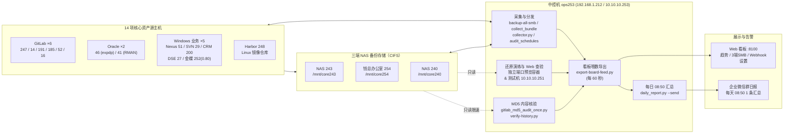

# 核心资产备份平台运维操作手册

> **安全与合规红线**
> 1. 本文档严格脱敏，**不包含**任何主机密码、SMB 凭据、企业微信 Webhook Key、私钥或真实业务数据；所有凭据均保存在服务器本机受限目录（Linux `0600 root:root` / Windows DPAPI 受限 ACL）。
> 2. **绝不擅自删除历史生产备份**、不重启生产业务服务、不放宽防火墙或认证策略。
> 3. **五项校验严格独立**：副本到位 ≠ 大小核对 ≠ MD5 一致 ≠ 还原演练通过 ≠ 人工业务验收；**连接/采集异常不等于备份丢失**。
> 4. **标准执行顺序**：`① 数据备份与三副本到位` → `② 还原演练与 Web 查验` → `③ 低峰温和 MD5 核验`（避免高并发读盘挤占 NAS 带宽）。

---

## 一、系统总览与核心架构

### 1.1 整体数据流



### 1.2 三端 NAS 挂载与展示对照

| 标识 | 看板显示名称 | SMB 共享路径（Windows） | `ops253` 挂载点 | 挂载凭据文件（`0600`） |
| :--- | :--- | :--- | :--- | :--- |
| `nas243` | NAS 243（研发备份存储） | `\\10.10.11.243\资源备份` | `/mnt/core243` | `/root/.smb-nas243` |
| `win254` | 钱总办公室 | `\\10.10.10.254\资源备份` | `/mnt/core254` | `/root/.smb-share254` |
| `nas240` | NAS 240（研发备份存储） | `\\192.168.5.240\资源备份`（金蝶网段走 `\\192.168.6.240\资源备份`，同物理共享） | `/mnt/core240` | `/root/.smb-nas240` |

> 操作前务必先用 `findmnt /mnt/core243 /mnt/core240 /mnt/core254` 确认均为 `cifs` 挂载，**严禁在未挂载时向空目录写入数据**（会写满中控机根盘）。

### 1.3 14 项核心资产总览表

| # | 资产 ID | 主机 IP | 系统 | 备份方式 | 当前配置目标 NAS | NAS 根目录名 | 定时触发点 |
| :-: | :--- | :--- | :--- | :--- | :--- | :--- | :--- |
| 1 | `247` | `10.10.10.247` | Linux | GitLab 10.5.4 + 集中分发 | `nas243`, `nas240`, `win254` | `gitlab01_10.10.10.247_代码主库` | 源机 cron `01:00` + 中控每小时 `:20` |
| 2 | `14` | `10.10.10.14` | Linux | GitLab 10.5.4 + 集中分发 | `nas243`, `nas240`, `win254` | `gitlab02_10.10.10.14_代码主库2` | 源机 cron `00:00` + 中控每小时 `:20` |
| 3 | `191` | `10.10.10.191` | Linux | GitLab 10.5.4 + 集中分发 | `nas243`, `nas240`, `win254` | `gitlab03_10.10.10.191_战略平台组` | 源机 cron `01:00` + 中控每小时 `:20` |
| 4 | `185` | `10.10.10.185` | Linux | GitLab 18.1.0 + 集中分发 | `nas243`, `nas240`, `win254` | `gitlab04_10.10.10.185_处方外配组` | 源机 cron `01:00` + 中控每小时 `:20` |
| 5 | `52` | `10.10.10.52` | Linux | GitLab 10.5.8 + 集中分发 | `nas243`, `nas240`, `win254` | `gitlab05_10.10.10.52_移动医生产品` | 源机 cron `01:00` + 中控每小时 `:20` |
| 6 | `16` | `192.168.0.16` | Linux | GitLab 10.0.3 + 集中分发 | `nas243`, `nas240`, `win254` | `gitlab06_192.168.0.16_腾医产品` | 源机 cron `01:00` + 中控每小时 `:20` |
| 7 | `oracle46` | `10.10.10.46` | Windows | Oracle 11.2.0.1 `expdp` 直写 NAS243 + 中控分发 | `nas243`, `win254` *(nas240 待跨NAS补齐)* | `oracle01_10.10.10.46_dev研发环境数据库` | 源机 `CoreOracle46-Daily` `00:00` + 中控 `:20` |
| 8 | `oracle41` | `10.10.10.41` | Windows | Oracle 11.2.0.4 `RMAN` 直写 NAS243 + 中控分发 | `nas243`, `nas240`, `win254` | `oracle02_10.10.10.41_uat测试环境数据库` | 源机 `CoreOracle41-Daily` `02:00` + 中控 `:20` |
| 9 | `nexus51` | `10.10.10.51` | Windows | 方案 A（热打 tar + 短停服增量 Delta） | `nas243`, `nas240`, `win254` | `nexus01_10.10.10.51_maven制品库` | 源机 `CoreBackup-Nexus51` `03:00` |
| 10 | `svn29` | `192.168.0.29` | Windows | `SYSTEM` `svnadmin hotcopy` + `verify` | `nas240` *(243/254 待跨NAS补齐)* | `svn01_192.168.0.29_svn代码库` | 源机 `CoreBackup-SVN29` `01:00` |
| 11 | `harbor248` | `10.10.11.248` | Linux | 中控每周全量归档分发三端 | `nas243`, `nas240`, `win254` | `harbor01_10.10.11.248_镜像仓库` | 中控 `core-harbor-weekly.timer` 周日 `03:00` |
| 12 | `crm200` | `192.168.0.200` | Windows | SQL Server 2008 R2 `SQLCMD` 备份 | `nas240` *(243/254 待跨NAS补齐)* | `crm01_192.168.0.200_crm` | 源机 `CoreBackup-CRM200` `03:00` |
| 13 | `dse27` | `192.168.0.27` | Windows | 源机写 NAS240 + 中控跨 NAS 分发三端 | `nas243`, `nas240`, `win254` | `dse01_192.168.0.27_dse` | 源机 `CoreBackup-DSE27` `03:00` + 中控 `:20` |
| 14 | `kingdee252` | `192.168.0.80` *(业务 6.252)* | Windows | 金蝶 `.ADF` 账套 `robocopy` 原子发布 | `nas240` *(243/254 待跨NAS补齐)* | `Kingdee01_192.168.6.252_金蝶账套` | 源机 `CoreBackup-Kingdee252` `03:00` |

---

## 二、脚本、配置、日志与凭证路径清单

### 2.1 中控机 `ops253`（`192.168.1.212` / `10.10.10.253`）目录地图

| 目录 / 文件路径 | 职责说明 |
| :--- | :--- |
| `/opt/core-backup-platform/` | **平台核心脚本目录**：`check_connections.py`（连接检查）、`audit_schedules.py`（计划巡检）、`collect_bundle.py` / `collect-when-published.py` / `bundle_transfer.py`（Oracle/DSE 跨 NAS 分发）、`observe_oracle.py` / `observe_nexus.py` / `observe_restore.py`（只读观测）、`export-board-feed.py` + `feed_extras.py` + `model.py`（看板喂数）、`daily_report.py`（08:50 日报）、`webhook_test_runner.py`（Webhook 测试桥接）、`gitlab_md5_audit_once.py`（GitLab 三端限速 MD5 核验） |
| `/opt/backup-console/` | **采集总控与资产清单**：`config.json`（14 项资产与目标 NAS 映射）、`collector.py` / `console.py`（每 15 分钟扫描三端 NAS 生成 `snapshot.json`） |
| `/opt/core-backup-modular/` | **GitLab 集中采集分发与通知**：`backup-all-smb.py`（每小时 `:20` 采集分发）、`verify-history.py`（每周六 18:00 历史 MD5 复核）、`notify.py`（企业微信发送器） |
| `/opt/harbor-backup/` | **Harbor 248 每周备份**：`harbor-backup.py`、`schedule-gate.py` |
| `/opt/core-backup-restore/` | **还原演练脚本目录**：`restore185-isolated.py`、`restore_gitlab_<id>_isolated.py`、`restore-crm200-isolated.py`、`restore-dse27-isolated.py`、`restore-svn29.py` |
| `/opt/backup-board/` | **Web 看板运行与访问代理**：`start-access-proxy.sh`（宿主机 `8100` 转发至当前生效看板容器） |
| `/opt/core-remote/` | **WinRM 远程工具环境**：`venv-modern/bin/python`（兼容旧版 Windows NTLM MD4 的独立 Python 环境） |
| `/var/lib/backup-console/` | **核心运行态数据**：`snapshot.json`、`restore/<id>.json`（还原证据）、`standard-report.md`（每日标准汇总）、`daily-summary-sent.json`（当日去重标记） |
| `/var/lib/backup-board-feed/` | **Web 看板只读喂数目录**（挂载给看板容器 `:ro`）：`snapshot.json`、`history-7d.json`、`smb-browser.json` |
| `/var/lib/backup-board-notify/` | **Webhook 私有目录（`0600`）**：`daily-webhook.json`、`test-request.json`、`test-result.json` |
| `/var/lib/core-backup-ops/content-audits/` | **独立 MD5 核验证据目录**：`<id>.json`（看板据此将“待 MD5”转为绿色“已确认副本齐全”） |
| `/etc/core-backup-platform/` | **Bundle 分发配置**：`oracle46-bundle.json`、`oracle41-bundle.json`、`dse27-bundle.json` |
| `/etc/core-remote/credentials/` | **各主机受限凭据（`0600 root:root`）**：包含生产主机及测试机 `oracle-restore251.json`，切勿公开或提交到 Git |
| `/var/log/` | **核心日志**：`core-backup-all-smb.log`、`core-backup-history-md5.log`、`core-backup-standard-report.log`、`core-backup-schedule-audit.log`、`core-oracle46-bundle.log`、`core-oracle41-bundle.log`、`core-dse27-bundle.log`、`harbor-backup.log`、`core-backup-restore-gitlab*.log` |

### 2.2 各源主机本地脚本位置与本仓库源码对照

| 资产 | 源主机本地部署路径 | 源主机计划任务 / Cron | 本仓库源码路径 |
| :--- | :--- | :--- | :--- |
| GitLab ×6 | `/opt/core-backup/gitlab-backup.sh`；配置 `/etc/core-backup/gitlab.conf`；日志 `/var/log/core-backup/gitlab.log` | `root` crontab（`14` 为 `00:00`，其余为 `01:00`） | *(现网脚本，中控在 `/opt/core-backup-modular/`)* |
| Oracle 46 | `C:\core-backup\oracle-direct-nas\`；DPAPI `C:\ProgramData\CoreOracleNas46\` | `CoreOracle46-Daily`（每日 `00:00`） | `components/oracle/` |
| Oracle 41 | `C:\core-backup\`；DPAPI `C:\ProgramData\CoreOracleNas41\` | `CoreOracle41-Daily`（每日 `02:00`） | `components/oracle/` |
| Nexus 51 | `C:\core-backup\`（`nexus-backup.ps1`、`pax-tar.ps1`、`nexus-config.ps1`） | `CoreBackup-Nexus51`（每日 `03:00`） | `components/nexus/` |
| SVN 29 | `C:\ProgramData\CoreSvnBackup\`（`svn-backup.ps1`、`svn-core.ps1`、`launch-svn.cmd`、`nas240.dpapi`） | `CoreBackup-SVN29`（`SYSTEM`，每日 `01:00`） | `components/svn/` |
| CRM 200 | `C:\core-backup\`（`backup.ps1`、`config.ps1`） | `CoreBackup-CRM200`（每日 `03:00`） | `components/crm/` |
| DSE 27 | `C:\core-backup\`（`backup.ps1`、`config.ps1`） | `CoreBackup-DSE27`（每日 `03:00`） | `components/dse/` |
| 金蝶 252 (`0.80`) | `C:\core-backup\`（`backup.ps1`、`config.ps1`、`select-day.ps1`、`nas-credential.xml`） | `CoreBackup-Kingdee252`（`JIND\administrator`，每日 `03:00`） | `components/kingdee/` |
| Harbor 248 | 由 `ops253` `/opt/harbor-backup/harbor-backup.py` 远程拉取 | `ops253` `core-harbor-weekly.timer`（周日 `03:00`） | `components/harbor/` |
| Web 看板 | `ops253` `/opt/backup-board/` + 容器 `core-backup-board-ui03-20261126` | `core-backup-board-feed.timer`（每 60s） | `apps/board/` |

---

## 三、手动触发备份操作指南

### 3.0 执行前通用安全检查（必做）

登录 `ops253`（`root` 或 `sudo -i`）：

```bash
# 1. 确认三端均为 cifs 挂载且空间充足
findmnt /mnt/core243 /mnt/core240 /mnt/core254
df -h / /mnt/core243 /mnt/core240 /mnt/core254

# 2. 检查 14 项核心资产网络连通性
python3 /opt/core-backup-platform/check_connections.py

# 3. 检查是否已有长耗时备份在跑（切勿并发重跑同类全量任务）
ps -ef | grep -E "backup-all-smb|collect_bundle|collect-when-published|harbor-backup|gitlab_md5" | grep -v grep
```

### 3.1 GitLab 6 台（`247 / 14 / 191 / 185 / 52 / 16`）手动备份

```bash
# 步骤 1：SSH 登录目标 GitLab 源机（如 10.10.10.52），触发本地备份
/opt/core-backup/gitlab-backup.sh
tail -n 50 /var/log/core-backup/gitlab.log

# 步骤 2：在 ops253 上触发集中采集并原子分发至三端 NAS（跳过 MD5，快速到位）
/usr/bin/python3 -u /opt/core-backup-modular/backup-all-smb.py --collect-only --verify-md5 off 2>&1 | tee -a /var/log/core-backup-all-smb.log

# 查看分发汇总结果
cat /var/lib/core-backup-ops/modular/last-report.json
```

### 3.2 Oracle 46（`expdp`）与 Oracle 41（`RMAN`）手动备份

> 切勿并发启动重复全库任务；启动前先确认 `schtasks /Query` 不是 `Running`（状态码 `4` / LastResult `267009` 表示运行中）。

```cmd
:: Oracle 46 (10.10.10.46) 触发全库 expdp 直写 NAS243
schtasks /Query /TN "CoreOracle46-Daily" /V /FO LIST
schtasks /Run /TN "CoreOracle46-Daily"

:: Oracle 41 (10.10.10.41) 触发 RMAN 全备+归档+原生校验直写 NAS243
schtasks /Query /TN "CoreOracle41-Daily" /V /FO LIST
schtasks /Run /TN "CoreOracle41-Daily"
```

在 `ops253` 触发跨 NAS 分发并查看进度：

```bash
# Oracle 46（待 NAS243 发布后分发到 win254）
/usr/bin/python3 /opt/core-backup-platform/collect-when-published.py --config /etc/core-backup-platform/oracle46-bundle.json >> /var/log/core-oracle46-bundle.log 2>&1 &

# Oracle 41（待 NAS243 发布后并行分发到 nas240 & win254）
/usr/bin/python3 /opt/core-backup-platform/collect_bundle.py --config /etc/core-backup-platform/oracle41-bundle.json >> /var/log/core-oracle41-bundle.log 2>&1 &

# 查看实时同步进度
cat /var/lib/core-backup-ops/oracle46/last-result.json
cat /var/lib/core-backup-ops/oracle41/last-result.json
```

### 3.3 Nexus 51（`10.10.10.51`）手动备份

> 方案 A 会在热打 tar 后进入短暂停服增量阶段（上限 `240s`，内置 8 分钟看门狗自动拉起 `nexus-webapp`），手动触发务必选在非高峰期。

```cmd
:: 零停机预检（约 5 秒）
powershell.exe -NoProfile -ExecutionPolicy Bypass -File C:\core-backup\nexus-backup.ps1 -CheckOnly

:: 低峰期触发正式备份
schtasks /Run /TN "CoreBackup-Nexus51"
schtasks /Query /TN "CoreBackup-Nexus51" /V /FO LIST
```

### 3.4 SVN 29（`192.168.0.29`）手动备份

```cmd
:: 环境/凭据/SMB 预检
C:\ProgramData\CoreSvnBackup\launch-svn.cmd -CheckOnly

:: 启动全量 12 仓库 hotcopy + svnadmin verify + 原子发布（SYSTEM 后台运行）
schtasks /Run /TN "CoreBackup-SVN29"
type C:\ProgramData\CoreSvnBackup\task-output.log | more
```

### 3.5 Harbor 248（`10.10.11.248`）手动备份

```bash
# 在 ops253 上通过 systemd 触发（自动检查防重入门禁）
systemctl start core-harbor-weekly.service
tail -f /var/log/harbor-backup.log
```

### 3.6 CRM 200 / DSE 27 / 金蝶 252（`0.80`）手动备份

```cmd
:: CRM 200 (192.168.0.200)
schtasks /Run /TN "CoreBackup-CRM200"

:: DSE 27 (192.168.0.27)
schtasks /Run /TN "CoreBackup-DSE27"

:: 金蝶 252 (管理 IP 192.168.0.80) —— 必须通过计划任务执行以使用 JIND\administrator DPAPI 凭据
schtasks /Run /TN "CoreBackup-Kingdee252"
```

DSE 27 源机完成后在 `ops253` 触发跨 NAS 分发：
```bash
/usr/bin/python3 /opt/core-backup-platform/collect_bundle.py --config /etc/core-backup-platform/dse27-bundle.json >> /var/log/core-dse27-bundle.log 2>&1
```

### 3.7 手动立即刷新看板数据

```bash
/usr/bin/flock -n /var/lib/backup-console/collect.lock /usr/bin/python3 /opt/backup-console/console.py --collect
systemctl start core-backup-board-feed.service
```

---

## 四、手动修改定时任务操作指南

> 任何修改前务必先备份原始定义；修改后在 `ops253` 运行 `audit_schedules.py` 刷新看板定时计划视图。

### 4.1 中控机 `ops253` 定时任务清单与修改

#### A. `/etc/cron.d/` 定时任务（日报推送时间、采集与分发频率）

| Cron 文件 | 当前计划 | 用途 |
| :--- | :--- | :--- |
| `/etc/cron.d/core-backup-standard-report` | `40 8 * * *` 计划巡检<br>`17 * * * *` 刷新标准结果<br>`50 8 * * *` **每日 08:50 企业微信日报** | **改日报发送时间即改此文件 `50 8 * * *`** |
| `/etc/cron.d/backup-console` | `*/15 * * * *` 全量采集<br>`5 9 * * *` 旧文本报告 | 快照扫描频率 |
| `/etc/cron.d/core-oracle46-bundle` / `core-oracle41-bundle` / `core-dse27-bundle` | `20 * * * *` | 跨 NAS 归集分发轮询 |
| `/etc/cron.d/core-oracle-observer` / `core-nexus-observer` / `core-restore-observer` | `*/5 * * * *` | 每 5 分钟只读观测进度 |

```bash
# 示例：将每日 08:50 日报调整为 09:00
cp -a /etc/cron.d/core-backup-standard-report /var/lib/core-backup-ops/core-backup-standard-report.bak.$(date +%Y%m%d%H%M)
vi /etc/cron.d/core-backup-standard-report
chmod 644 /etc/cron.d/core-backup-standard-report
grep -i cron /var/log/syslog | tail -n 20
```

#### B. `root` crontab（GitLab 每小时采集 & 周六历史 MD5）

```bash
crontab -l > /var/lib/core-backup-ops/root-crontab.bak.$(date +%Y%m%d%H%M)
crontab -e
crontab -l
```

#### C. `systemd timer`（Harbor 每周时间 / 看板喂数间隔）

```bash
cp -a /etc/systemd/system/core-harbor-weekly.timer /var/lib/core-backup-ops/core-harbor-weekly.timer.bak.$(date +%Y%m%d%H%M)
vi /etc/systemd/system/core-harbor-weekly.timer
systemctl daemon-reload
systemctl restart core-harbor-weekly.timer
systemctl list-timers --all | grep -E "NEXT|harbor|board-feed"
```

### 4.2 源主机定时任务修改

- **GitLab Linux 源机**：`crontab -l > /root/crontab.bak.$(date +%Y%m%d%H%M)` 后 `crontab -e` 修改 `/opt/core-backup/gitlab-backup.sh` 触发时间。
- **Windows 源机（管理员 CMD）**：
  ```cmd
  :: 1. 先导出原任务 XML 备份
  schtasks /Query /TN "CoreBackup-SVN29" /XML > C:\core-backup\task-CoreBackup-SVN29-bak.xml

  :: 2. 修改每日启动时间（示例：01:30）
  schtasks /Change /TN "CoreBackup-SVN29" /ST 01:30

  :: 3. 临时暂停 / 恢复任务（不删任务）
  schtasks /Change /TN "CoreBackup-Nexus51" /DISABLE
  schtasks /Change /TN "CoreBackup-Nexus51" /ENABLE

  :: 4. 核对下次运行时间
  schtasks /Query /TN "CoreBackup-SVN29" /V /FO LIST
  ```
- 修改后在 `ops253` 刷新定时计划看板：
  ```bash
  /usr/bin/python3 /opt/core-backup-platform/audit_schedules.py
  systemctl start core-backup-board-feed.service
  ```

---

## 五、手动还原测试指南（支持暴露内网端口 Web 登录验收）

> **还原安全底线**：
> 1. 允许将还原测试容器暴露到内网管理端口（如 `http://192.168.1.212:18xxx`）供管理员**浏览器直接登录查验代码、用户、权限与提交记录**。
> 2. 暴露 Web 端口时，**仍必须关闭所有对外通知与外发动作**（`smtp_enable = false`、`gitlab_email_enabled = false`、`registry = false`、不接生产 Runner/Webhook），绝不连接或写入任何生产数据库/生产代码库。
> 3. `ops253` 同时常驻多个 GitLab 容器会消耗较多内存（每台约 2–3 GB），建议按需保留当前待人工验收的容器，验收完毕后停删临时容器并保留 `evidence/` 与 `/var/lib/backup-console/restore/<id>.json`。

### 5.1 GitLab 还原演练与 Web 登录测试（`ops253`）

#### 精准版本镜像与推荐内网验收端口规划

| GitLab 资产 | 生产版本 | `ops253` 本地镜像 | 推荐内网 Web 验收入口 | 还原命令差异 |
| :--- | :--- | :--- | :--- | :--- |
| `185` | `18.1.0` | `core-restore/gitlab185:18.1.0-20261123` | `http://192.168.1.212:18185` | 停 `puma`/`sidekiq`；`gitlab-backup restore` |
| `52` | `10.5.8` | `core-restore/gitlab-ce:10.5.8-ce.0` | `http://192.168.1.212:18052` | 停 `unicorn`/`sidekiq`；`gitlab-rake gitlab:backup:restore` |
| `247` | `10.5.4` | `core-restore/gitlab-ce:10.5.4-ce.0` | `http://192.168.1.212:18247` | 停 `unicorn`/`sidekiq`；`gitlab-rake gitlab:backup:restore` |
| `191` | `10.5.4` | `core-restore/gitlab-ce:10.5.4-ce.0` | `http://192.168.1.212:18191` | 停 `unicorn`/`sidekiq`；`gitlab-rake gitlab:backup:restore` |
| `16` | `10.0.3` | `core-restore/gitlab-ce:10.0.3-ce.0` | `http://192.168.1.212:18016` | 停 `unicorn`/`sidekiq`；`gitlab-rake gitlab:backup:restore` |
| `14` | `10.5.4` | `core-restore/gitlab-ce:10.5.4-ce.0` | `http://192.168.1.212:18014` | 停 `unicorn`/`sidekiq`；`gitlab-rake gitlab:backup:restore` |

#### 手动还原并暴露内网 Web 登录端口（GitLab 10.x 通用模板）

```bash
# 1. 参数设定（以 GitLab 52 为例；其他节点按上表替换 GID / IMG / PORT / SRC）
GID=52
PORT=18052
IMG="core-restore/gitlab-ce:10.5.8-ce.0"
SRC="/mnt/core243/gitlab05_10.10.10.52_移动医生产品/2026-11-26/<实际运行目录>"
ROOT="/var/lib/core-backup-restore/gitlab${GID}/webtest-$(date +%Y%m%d)"
mkdir -p "$ROOT"/{config,logs,data/backups,evidence}

# 2. 只读拷贝备份 tar 与配置包，并核对拷贝前后 MD5 一致
cp "$SRC"/*_gitlab_backup.tar "$ROOT/data/backups/"
cp "$SRC"/gitlab-config.tar.gz "$ROOT/evidence/"
md5sum "$SRC"/*_gitlab_backup.tar "$ROOT/data/backups/"*_gitlab_backup.tar

# 3. 提取 gitlab-secrets.json，配置暴露端口及禁用所有外发邮件/监控
tar -xOf "$ROOT/evidence/gitlab-config.tar.gz" etc/gitlab/gitlab-secrets.json > "$ROOT/config/gitlab-secrets.json"
cat > "$ROOT/config/gitlab.rb" <<EOF
external_url 'http://192.168.1.212:${PORT}'
nginx['listen_port'] = ${PORT}
letsencrypt['enable'] = false
gitlab_rails['smtp_enable'] = false
gitlab_rails['gitlab_email_enabled'] = false
gitlab_rails['usage_ping_enabled'] = false
registry['enable'] = false
prometheus_monitoring['enable'] = false
unicorn['worker_processes'] = 2
EOF

# 4. 启动测试容器并映射内网端口（供浏览器访问 http://192.168.1.212:${PORT}）
docker run -d --name "core-restore-gitlab${GID}-web" \
  --hostname "restore${GID}.local" --restart no \
  -p "0.0.0.0:${PORT}:${PORT}" \
  --cpus 2 --memory 4g --memory-swap 6g --shm-size 256m \
  -v "$ROOT/config:/etc/gitlab" \
  -v "$ROOT/logs:/var/log/gitlab" \
  -v "$ROOT/data:/var/opt/gitlab" \
  "$IMG"

# 5. 等待首次初始化就绪（约 6-10 分钟）
until docker exec "core-restore-gitlab${GID}-web" curl -fsS --max-time 5 "http://127.0.0.1:${PORT}/users/sign_in" >/dev/null; do
  sleep 10
done

# 6. 停写服务并执行还原（BACKUP= 去掉末尾 _gitlab_backup.tar）
TAR_NAME=$(basename "$ROOT"/data/backups/*_gitlab_backup.tar)
BACKUP_ID="${TAR_NAME%_gitlab_backup.tar}"
docker exec "core-restore-gitlab${GID}-web" chown git:git "/var/opt/gitlab/backups/$TAR_NAME"
docker exec "core-restore-gitlab${GID}-web" gitlab-ctl stop unicorn
docker exec "core-restore-gitlab${GID}-web" gitlab-ctl stop sidekiq
docker exec -e GITLAB_ASSUME_YES=1 "core-restore-gitlab${GID}-web" \
  gitlab-rake gitlab:backup:restore BACKUP="$BACKUP_ID" force=yes

# 7. 重载重启 + 自动完整性校验 + Rails 抽检
docker exec "core-restore-gitlab${GID}-web" gitlab-ctl reconfigure
docker exec "core-restore-gitlab${GID}-web" gitlab-ctl restart
sleep 15
docker exec "core-restore-gitlab${GID}-web" gitlab-rake gitlab:check SANITIZE=true
docker exec "core-restore-gitlab${GID}-web" gitlab-rails runner \
  "require 'json'; puts({users:User.count,projects:Project.count,groups:Group.count,repos:Project.where(pending_delete:false).limit(5).map{|p|{id:p.id,path:p.full_path,exists:p.repository.exists?}}}.to_json)"

# 8. 浏览器直接打开 http://192.168.1.212:${PORT} 使用原 GitLab 账号密码登录抽检代码库！
# 9. 人工 Web 验收确认完毕后，释放容器与临时数据（保留 $ROOT/evidence）：
# docker rm -f "core-restore-gitlab${GID}-web"
# rm -rf "$ROOT/data" "$ROOT/logs" "$ROOT/config"
```

> 如需后台无人值守跑完自动清理（不占内存），直接运行 `/opt/core-backup-restore/restore_gitlab_<id>_isolated.py`（结果自动发布至 `/var/lib/backup-console/restore/<id>.json`）。

### 5.2 CRM 200 / DSE 27 / SVN 29 手动还原测试

```bash
# CRM 200（SQL Server 容器：RESTORE VERIFYONLY + 隔离恢复 + 核心表行数抽检）
python3 /opt/core-backup-restore/restore-crm200-isolated.py

# DSE 27（SQL Server 容器恢复与表抽检）
python3 /opt/core-backup-restore/restore-dse27-isolated.py

# SVN 29（hotcopy 仓库 UUID / HEAD / svnadmin verify 全检）
python3 /opt/core-backup-restore/restore-svn29.py

# 查看所有已发布的还原证据 JSON
ls -la /var/lib/backup-console/restore/
```

### 5.3 Oracle 46（`expdp`）与 Oracle 41（`RMAN`）还原测试（测试机 `10.10.10.251`）

> 仅允许在独立测试机 `10.10.10.251` 上执行（安装 **Oracle 11.2.0.4.0 Enterprise Edition 64-bit Windows**，同时支持 `oracle41` RMAN 与 `oracle46` `impdp`），严禁连接生产 `10.10.10.46` / `10.10.10.41`。

1. **Oracle 46（`expdp` Dump 还原验证）**：
   ```cmd
   :: 将 NAS 上最新已发布的 FULL_01..08.DMP 只读拷贝至 C:\oracle-restore\ora46\
   :: 在 251 测试库创建 DIRECTORY RESTORE46_DIR 指向该目录后：
   impdp \"/ as sysdba\" DIRECTORY=RESTORE46_DIR DUMPFILE=FULL_%U.DMP LOGFILE=impdp_sqlfile.log SQLFILE=full_ddl_check.sql FULL=Y
   impdp \"/ as sysdba\" DIRECTORY=RESTORE46_DIR DUMPFILE=FULL_%U.DMP LOGFILE=impdp_verify.log SCHEMAS=<业务Schema名> TABLE_EXISTS_ACTION=REPLACE
   ```
2. **Oracle 41（`RMAN` 异机恢复，`DBID=381249458`，`SID=YUANQI`）**：
   ```sql
   SET DBID 381249458;
   STARTUP NOMOUNT;
   RESTORE SPFILE TO PFILE 'C:\oracle-restore\initYUANQI_test.ora' FROM 'C:\oracle-restore\ora41\<控制文件备份片>';
   -- 调整 pfile 内存与本地目录后：
   SHUTDOWN ABORT;
   STARTUP NOMOUNT PFILE='C:\oracle-restore\initYUANQI_test.ora';
   RESTORE CONTROLFILE FROM 'C:\oracle-restore\ora41\<控制文件备份片>';
   ALTER DATABASE MOUNT;
   CATALOG START WITH 'C:\oracle-restore\ora41\' NOPROMPT;
   RUN {
     SET NEWNAME FOR DATABASE TO 'C:\oracle-restore\oradata\%b';
     RESTORE DATABASE;
     SWITCH DATAFILE ALL;
     RECOVER DATABASE;
   }
   ALTER DATABASE OPEN RESETLOGS;
   ```
3. **发布还原证据至看板**：将生成的标准证据写入 `ops253:/var/lib/backup-console/restore/oracle46.json` 与 `oracle41.json` 后执行 `systemctl start core-backup-board-feed.service`。

---

## 六、Web 看板查验与运维指南

### 6.1 访问入口与服务架构

- **访问地址**：`http://192.168.1.212:8100/`（或 `http://10.10.10.253:8100/`）
- **服务链路**：`backup-board-access.socket` (`0.0.0.0:8100`) → `backup-board-access.service` (`/opt/backup-board/start-access-proxy.sh`) → Web 容器 `core-backup-board-ui03-20261126` + PostgreSQL `core-backup-board-db-1`。

### 6.2 页面逐项人工查验清单

1. **顶部 KPI 概览卡**：核对资产总数（`14`）、已确认副本齐全、文件已到位待 MD5、需关注/异常数、技术恢复通过数。
2. **14 项核心资产矩阵**：
   - `已到位`（绿）：有效正式回执且未超保鲜期；
   - `待 MD5`（黄）：文件与大小核对完成，待独立 MD5 核验；
   - `未配置`（灰）：尚未配置该端副本；
   - `记录过期` / `无有效记录`（红）：需排查源机或分发任务。
   - 点击任意资产行展开右侧详情抽屉，核对运行号、原生校验、定时计划与恢复证据路径。
3. **近 7 天备份成功率趋势图**：数据源 `/var/lib/backup-board-feed/history-7d.json`（仅基于三端 NAS 真实回执与持久化每日快照，不造假数据）。
4. **三端 SMB 备份目录实时浏览**：切换 `NAS 243` / `钱总办公室 254` / `NAS 240`，核对最新日期目录回执状态及是否存在异常滞留的 `.partial` 目录。
5. **每日 08:50 企业微信 Webhook 设置（管理员）**：
   - 点击右上角「**推送设置**」可自助开关每日 `08:50` 汇总推送、修改 Webhook 地址（留空不覆盖，密钥仅落盘宿主机 `0600` 文件 `/var/lib/backup-board-notify/daily-webhook.json`，前端脱敏仅显尾号）。
   - 点击「**立即测试推送**」通过宿主机 `core-backup-webhook-test.path` 桥接执行 `webhook_test_runner.py` 真实发送测试消息。

### 6.3 命令行健康自检（`ops253`）

```bash
# 容器与代理状态
docker ps --format "table {{.Names}}\t{{.Status}}" | grep -E "NAMES|board"
systemctl status backup-board-access.socket core-backup-board-feed.timer core-backup-webhook-test.path --no-pager

# HTTP 健康检查（预期返回 200）
curl -sS -o /dev/null -w "HTTP=%{http_code}\n" http://127.0.0.1:8100/

# 核对喂数文件时间戳（应为最近 1 分钟内）
ls -lh /var/lib/backup-board-feed/
python3 -c "import json; d=json.load(open('/var/lib/backup-board-feed/snapshot.json')); print('sampled=', d.get('sampled'), 'assets=', len(d.get('assets',[])))"

# 本地预览今日 08:50 日报内容（不发群消息）
/usr/bin/python3 /opt/core-backup-platform/daily_report.py

# 手工补发当日日报（内置当日去重保护）
/usr/bin/python3 /opt/core-backup-platform/daily_report.py --send
```

---

## 七、手动 MD5 完整性核验指南

> 请在全量备份与还原演练结束后、NAS 带宽空闲时执行，并配合 `ionice -c 3` 避免挤占 `/mnt/core240` CIFS 通道。

### 7.1 方式 A：GitLab 三端平台级限速 MD5 核验（自动更新看板）

```bash
# 1. 低 IO 优先级后台运行（自动核验 185/52/247/191/16/14 三端最新运行并写证据到 content-audits/）
ionice -c 3 nice -n 15 /usr/bin/python3 -u /opt/core-backup-platform/gitlab_md5_audit_once.py \
  >> /var/log/core-backup-gitlab-md5-audit.log 2>&1 &

# 2. 查看进度
tail -f /var/log/core-backup-gitlab-md5-audit.log

# 3. 如需临时暂停让出 NAS 带宽（安全无损，随时可续跑）
pkill -f gitlab_md5_audit_once.py

# 4. 完成后刷新看板（待 MD5 自动转为绿色“已确认副本齐全”）
systemctl start core-backup-board-feed.service
ls -lh /var/lib/core-backup-ops/content-audits/
```

### 7.2 方式 B：历史备份周度 MD5 复核脚本

```bash
ionice -c 3 /usr/bin/python3 -u /opt/core-backup-modular/verify-history.py >> /var/log/core-backup-history-md5.log 2>&1 &
tail -f /var/log/core-backup-history-md5.log
```

### 7.3 方式 C：单文件跨三端 NAS 纯手工哈希比对

```bash
# Linux (ops253)：逐字符比对三端 NAS 同文件 32 位 MD5 是否完全一致
REL="gitlab05_10.10.10.52_移动医生产品/2026-11-26/<运行号>/<文件名>"
ionice -c 3 md5sum "/mnt/core243/$REL" "/mnt/core254/$REL" "/mnt/core240/$REL"
```

```cmd
:: Windows 源机（兼容 Windows Server 2008 R2 / PowerShell 2.0）
certutil -hashfile "D:\路径\文件名.DMP" MD5
certutil -hashfile "D:\路径\文件名.DMP" SHA256
```

### 7.4 MD5 不一致应急处置

1. **严禁直接删除或覆盖任何一端副本**，先保留现场与日志。
2. 对比源机与其余两端一致的副本定位损坏端。
3. 将损坏端目录重命名移出排查，再触发补齐复制并二次执行 MD5 核验确认三端一致。

---

## 八、常见故障速查表

| 现象 | 常见原因 | 快速排查与处置 |
| :--- | :--- | :--- |
| 看板某台 NAS 标红 `error`/超时 | 并发大文件读写占满 CIFS 导致 `collector.py` 90s 超时（**不等于备份丢失**） | 检查 `findmnt /mnt/core240`；若在跑 MD5 先暂停；随后执行 `console.py --collect` 与 `systemctl start core-backup-board-feed.service` |
| Windows 计划任务 `LastResult=267009` | `0x41301` = **任务正在运行中**（正常状态，切勿重复启动） | 等待完成并查看对应日志 |
| 看板“立即测试推送”报 DNS 错误 | Web 容器断网隔离，须通过宿主机桥接发请求 | 检查 `systemctl status core-backup-webhook-test.path core-backup-webhook-test.service` |
| 金蝶 `0.80` 直接 WinRM 执行报 DPAPI 错误 | `nas-credential.xml` 绑定 `JIND\administrator` 身份 | 始终通过 `schtasks /Run /TN CoreBackup-Kingdee252` 运行 |
| 每日 `08:50` 未收到日报 | 当时快照处于 `collecting` 或过期超 30 分钟被延迟防发错数 | 检查 `/var/log/core-backup-standard-report.log` 及 `daily-webhook.json` 的 `Enabled` 状态，刷新快照后执行 `daily_report.py --send` |
